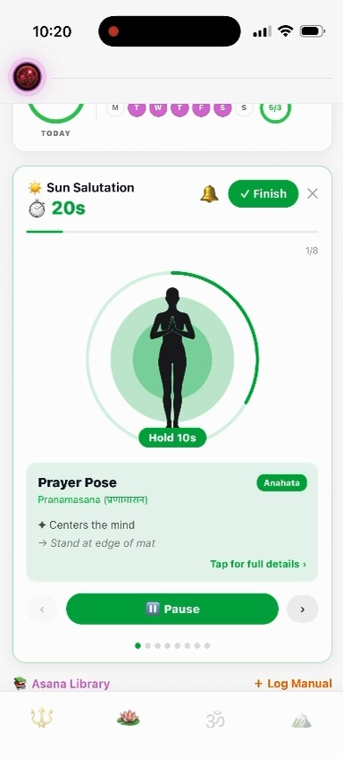

# Aroha

Aroha is a meditation and wellness app for building a mindful daily routine. It includes guided meditation, yoga practices, focus tools, workout tracking, and progress summaries. The app uses SQLite for local app data and Supabase for authentication.

## App demo

[](docs/aroha-demo.mp4)

Click the preview to watch a 2-minute walkthrough of workouts, yoga, and meditation. The H.264 MP4 is trimmed and optimized for web playback (about 8 MB).

## Requirements

- Node.js 20.19.4 or newer (Node.js 22 LTS is also supported)
- npm

## Install

From the project directory, install the locked dependencies:

```bash
npm ci
```

## Run the app

Start the web app:

```bash
npm run web -- --clear
```

Or start Expo and choose a platform:

```bash
npm start
```

The project also has shortcuts for Android and iOS:

```bash
npm run android
npm run ios
```

## Supabase setup

The Supabase project URL and publishable key are configured in `src/lib/supabase.ts`. Replace them with the URL and publishable key from your Supabase project's API settings when connecting the app to a different project. Keep privileged service-role keys out of the app; client apps should use a publishable key and appropriate database row-level security policies.

## Troubleshooting

- If dependency or Metro errors persist after changing branches or Node versions, run `npm ci` and restart Expo with `npx expo start --clear`.
- The Supabase client includes a `ws` transport fallback for Node runtimes without a native WebSocket. Browsers and React Native use their native WebSocket when available.
- Web SQLite needs the cross-origin isolation headers configured in `metro.config.js`; run the app through Expo/Metro rather than opening generated HTML directly from disk.
